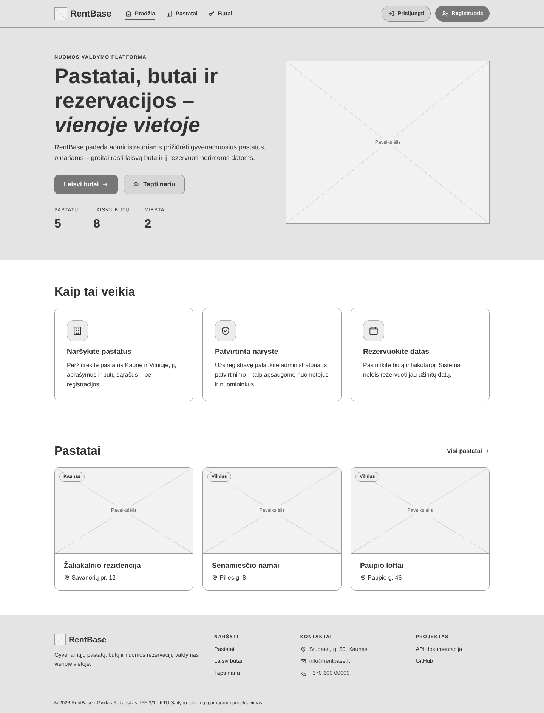
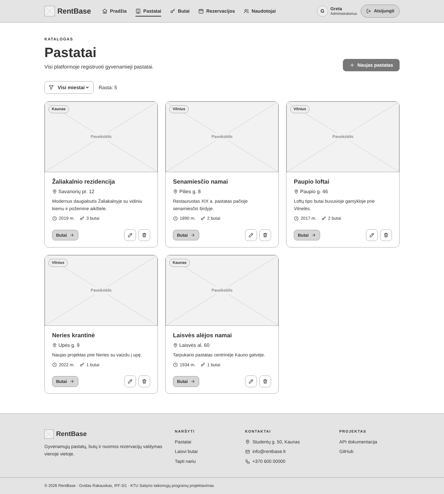
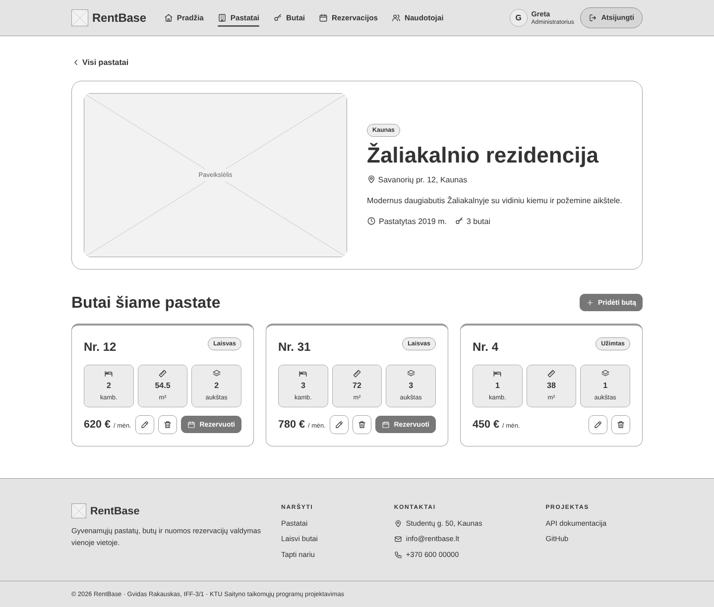
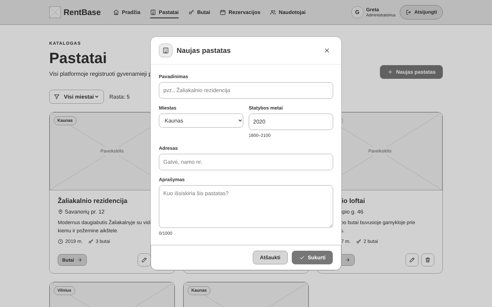
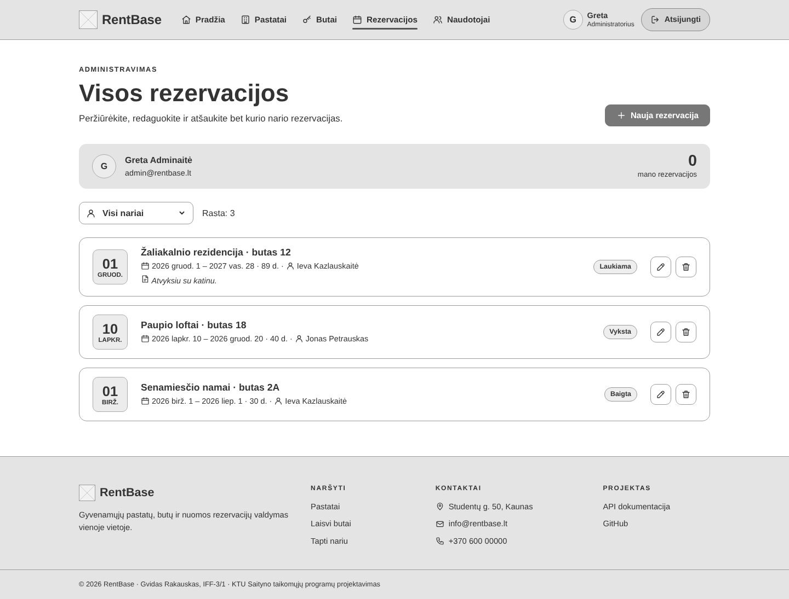
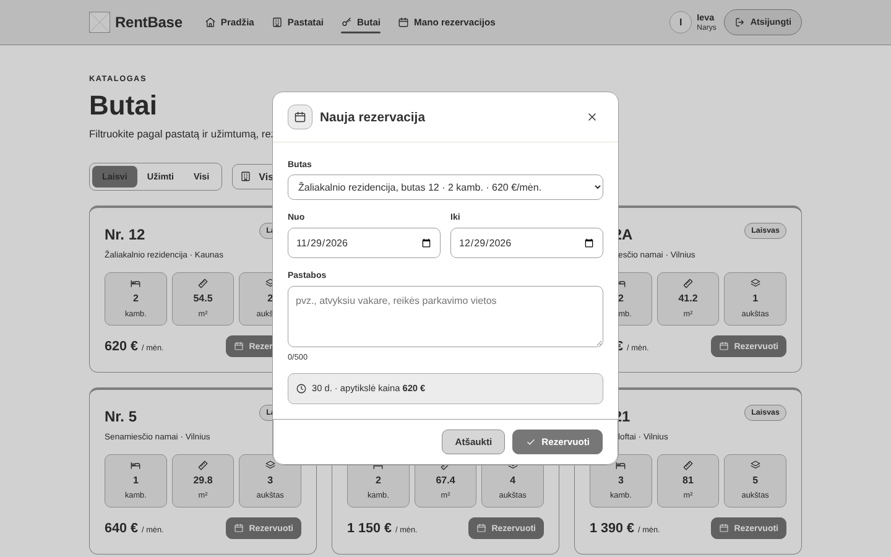
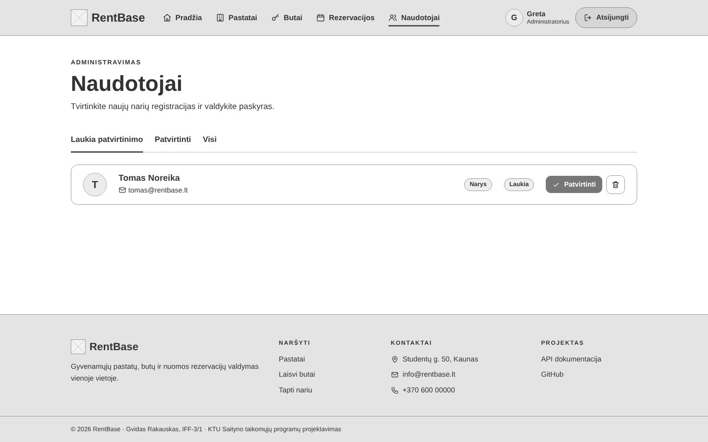
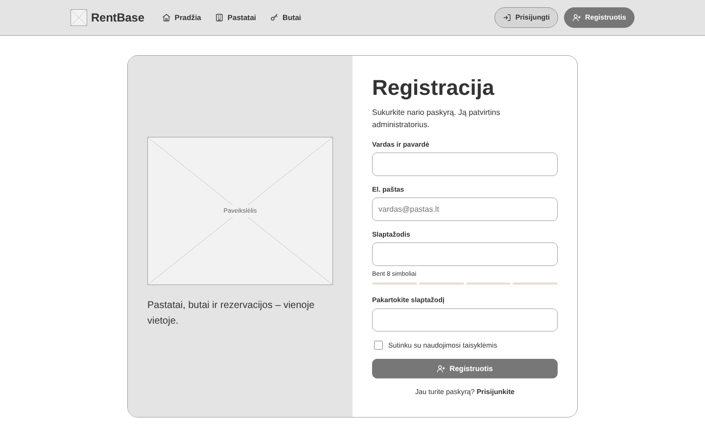
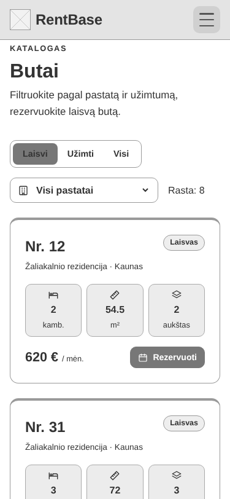
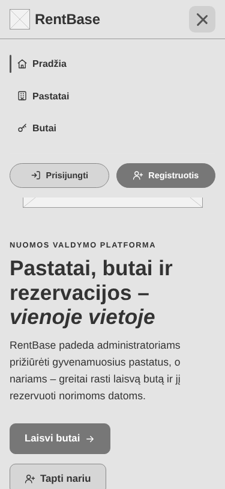

# RentBase

RentBase project for labs 1–3: buildings, apartments, member registrations and reservations, with JWT authentication, refresh tokens and role-based authorization.

**Live:** web app https://rentbase-web-gvirak.onrender.com · API / Swagger https://rentbase-api-gvirak.onrender.com/swagger (free tier: the first request after 15 min idle takes up to a minute).

Stack, matching the L0 report: ASP.NET Core 8 Web API, Entity Framework Core, PostgreSQL. The React client (lab 3) is in `frontend/`; see "Lab 3" below.

## What is implemented

16 REST methods. The course demo asks for 15; the extra method is user deletion, which the functional requirements also ask for. Both are in the Postman collection.

| # | Method | Path | Who | Status |
|---|--------|------|-----|--------|
| 1 | POST | `/api/auth/register` | guest | 201 |
| 2 | POST | `/api/auth/login` | guest | 200 |
| 3 | GET | `/api/buildings` | guest | 200 |
| 4 | POST | `/api/buildings` | admin | 201 |
| 5 | PUT | `/api/buildings/{id}` | admin | 200 |
| 6 | DELETE | `/api/buildings/{id}` | admin | 204 |
| 7 | GET | `/api/apartments` | guest | 200 |
| 8 | POST | `/api/apartments` | admin | 201 |
| 9 | PUT | `/api/apartments/{id}` | admin | 200 |
| 10 | DELETE | `/api/apartments/{id}` | admin | 204 |
| 11 | GET | `/api/reservations` | member or admin | 200 |
| 12 | POST | `/api/reservations` | member or admin | 201 |
| 13 | PUT | `/api/reservations/{id}` | owner or admin | 200 |
| 14 | DELETE | `/api/reservations/{id}` | owner or admin | 204 |
| 15 | PATCH | `/api/users/{id}/approval` | admin | 200 |
| 16 | DELETE | `/api/users/{id}` | admin | 204 |
| 17 | POST | `/api/auth/refresh` | refresh cookie | 200 |
| 18 | POST | `/api/auth/logout` | any | 204 |
| 19 | POST | `/api/auth/logout-all` | member or admin | 204 |
| 20 | GET | `/api/users` | admin | 200 |

## Authentication and authorization (lab 2)

### Roles

| Role | How | Can do |
|------|-----|--------|
| Guest | no token | browse buildings and apartments, register, log in |
| Member | `Member` in the token, approved by admin | own reservations and profile |
| Admin | `Admin` in the token | buildings, apartments, user approval and deletion, every reservation |

Role checks are `[Authorize(Roles = UserRoles.Admin)]` on the controllers. Ownership checks compare the reservation's `UserId` with the id from the token (`ReservationsController`), so a member gets `403` when reading, editing or cancelling someone else's reservation. Registration always creates an unapproved `Member`; a `role` field in the body is ignored.

### Tokens

- **Access token**: JWT, HMAC-SHA256, valid 15 minutes. Claims: `sub` (user id), role, `sid` (session id), `email`, `name`, `jti`, `exp`. Created in `Auth/JwtTokenService.cs`; signing key is `Jwt:Key` in `appsettings.json` (override with the `Jwt__Key` environment variable when deployed). Sent as `Authorization: Bearer <token>`.
- **Refresh token**: 64 random bytes, valid 7 days, stored only as a SHA-256 hash in the `UserSessions` table. Sent as the cookie `rb_refresh` with `HttpOnly`, `Secure` (off for local http), `SameSite`, and `Path=/api/auth`, so JavaScript cannot read it and it is not sent with ordinary API calls.
- **Rotation**: every `POST /api/auth/refresh` replaces the refresh token. If an old one is used again, the session is revoked (stolen-token detection).
- **Logout**: `POST /api/auth/logout` marks the session revoked. Every request's token is checked against its session in `Program.cs` (`OnTokenValidated`), so the access token stops working at once, not after 15 minutes. `logout-all` revokes every session of the user. Rejecting or deleting a user ends their sessions too.

### Auth status codes

- `401`: no token, forged or expired token, logged-out session, wrong password, bad refresh cookie. Body is JSON.
- `403`: valid token but wrong role (member creating a building) or not the owner (member deleting another member's reservation); login of an unapproved account.

The `Auth (lab 2)` Postman folder walks through all of this.

Guest apartment browsing is `GET /api/apartments?available=true`. Apartments of one building are `GET /api/apartments?buildingId=1`.

## Status codes the defense asks for

- Missing resource: `404`, for example `DELETE /api/buildings/99999`.
- Bad payload: `400`, for example `POST /api/buildings` with `{}`.
- Well-formed payload that breaks a rule: `422`, for example a reservation whose end date is not after the start date, or a date range that overlaps an existing reservation.
- Create: `201` and a `Location` header.
- Delete: `204` with no body.

Responses are `application/json`, except validation failures, which use `application/problem+json`.

## Lab 3: React client (`frontend/`)

React 19 single-page app built with Vite. It talks to the API only through `fetch` and JSON. There are no extra UI libraries: the router, icons and modals are small, readable files that are easy to explain at the defense.

### Run locally

Start the API (`dotnet run --project RentBase.Api`, port 8080), then in a second terminal:

```powershell
cd frontend
npm install
npm run dev
```

Open http://localhost:5173. Vite forwards `/api/*` and `/swagger/*` to `localhost:8080` (`vite.config.js`). The browser therefore sees a single origin, and the HttpOnly refresh cookie works without CORS.

Seed logins: `admin@rentbase.lt` / `Admin123!` (admin), `ieva@rentbase.lt` / `Member123!` (member). `tomas@rentbase.lt` is unapproved and is the one to approve on the **Naudotojai** page.

### UI design (wireframes)

Grey-box wireframes of the main screens are in [`docs/wireframes/`](docs/wireframes/): desktop at 1440 px, mobile at 375 px.

| Home | Building list (admin) |
|---|---|
|  |  |
| **Building with apartments** | **Create building (modal)** |
|  |  |
| **Reservations** | **New reservation (modal)** |
|  |  |
| **Users (admin)** | **Registration** |
|  |  |

| Mobile: apartments | Mobile: hamburger menu |
|---|---|
|  |  |

### Where each requirement lives

| Requirement | Where |
|---|---|
| CRUD for buildings, apartments, reservations | `pages/Buildings.jsx`, `components/ApartmentGrid.jsx`, `pages/Reservations.jsx`; forms in `forms/` |
| Register, login, token refresh, logout | `pages/Auth.jsx`, `auth.jsx`, `api.js` (`refreshSession`) |
| Token storage | access token in memory (`api.js`), refresh token in the HttpOnly cookie set by the API |
| Token refresh | on page load (keeps the session after a reload), on a timer 1 min before expiry, and after any 401 (request retried once). Only one refresh runs at a time, because the API detects reuse of a rotated token |
| Input types (≥4) | text, email, password, number, range (rooms), date, select, textarea, checkbox/switch, radio (availability filter) |
| Modals | `components/Modal.jsx`: create/edit forms and delete confirmation |
| No `alert()`, user feedback | toasts in `toast.jsx`, inline form errors (`FormError`) |
| Vector icons | `components/Icon.jsx`: inline SVG on a 24×24 grid, Lucide style. Used in the menu, buttons and cards |
| Responsive images | `img { max-width: 100%; height: auto }` in `styles.css`; building illustrations in `public/images/*.svg` |
| Custom fonts | Google Fonts `Fraunces` (headings) and `Manrope` (text), linked in `index.html`, used through `--font-display` / `--font-body` |
| Animations | `styles.css` section 7: page fade-in, cards rising in, skeleton shimmer while data loads, modal pop-in, toast slide, hover lifts, hamburger → X |
| Breakpoints | `@media (max-width: 768px)` (main: hamburger, one column) and `1024px` (two columns) at the end of `styles.css` |
| Hamburger menu | `components/Header.jsx` (`.hamburger`, `.main-nav.is-open`) |
| Header / content / footer look different | dark header with pill buttons and an underline bar, light content with rounded buttons, teal footer with growing-underline links |
| Grid alignment | every spacing is a multiple of `--space: 8px`; layouts use CSS grid with one `gap` |
| State | React Context for auth (`auth.jsx`), router (`router.jsx`) and toasts; `useState` inside pages |

Additional endpoint for this lab: `GET /api/users?approved=false&page=1&pageSize=10` (admin). It lists the registrations waiting for approval.

## Deploy to Render (free)

`render.yaml` is a Render Blueprint. It describes a free PostgreSQL database, the API (Docker) and the React static site.

1. Push the repository to GitHub.
2. On https://dashboard.render.com: **New → Blueprint**, connect GitHub and select `disusen/rentbase`. Render reads `render.yaml` and shows the three resources. Click **Apply**. No card is needed for free resources.
3. Wait for the API build (the first Docker build takes 5–10 min), then for the static site.
4. Check that the API address on its page is `https://rentbase-api-gvirak.onrender.com`. If Render added a suffix, change the two `destination` URLs in `render.yaml`, push, and the static site redeploys.
5. Open `https://rentbase-web-gvirak.onrender.com`.

How it fits together: the static site rewrites `/api/*` to the API service. The browser only talks to `rentbase-web-…`, so the refresh cookie is first-party. That matters because `onrender.com` subdomains count as different sites, and cross-site cookies are blocked by many browsers. The API reads Render's `postgresql://` URL and `PORT` in `Program.cs`. `Jwt__Key` is generated by Render, so the development key in `appsettings.json` is not used in production.

Free-tier notes:
- The API sleeps after 15 minutes without traffic, and the first request then takes up to a minute. Open the site a couple of minutes before presenting.
- The free database expires 30 days after creation. A new one is seeded automatically on first start.

## Seed data

Created on startup when the database is empty.

| Email | Password | Role | Approved |
|-------|----------|------|----------|
| admin@rentbase.lt | Admin123! | Admin | yes |
| ieva@rentbase.lt | Member123! | Member | yes |
| tomas@rentbase.lt | Member123! | Member | no |

Buildings: Žaliakalnio rezidencija (Kaunas), Senamiesčio namai (Vilnius), Paupio loftai (Vilnius), with apartments and one reservation for Ieva.

## Run without Docker

Docker is not required by the lab. It was only a convenience. Development mode uses a local SQLite file, `rentbase.db`, creates the schema, and seeds the same buildings, apartments, users and reservation.

Install the .NET 8 SDK, open this folder in VS Code, then:

```powershell
dotnet run --project RentBase.Api
```

Swagger is http://localhost:8080/swagger. The same command works on the M1 Mac.

The L0 report names PostgreSQL. For the defense, either run `docker compose up --build` on a machine where Docker works, or install PostgreSQL normally and set the connection string to `Host=localhost;Port=5432;Database=rentbase;Username=rentbase;Password=rentbase`. A native PostgreSQL install does not need virtualization. SQLite is the fallback when Docker cannot start.

## Postman demo

Import both files from `postman/`. Run the folder **Lab demo** with the collection runner. It logs in, calls the methods, and asserts status codes. The folder **Edge cases** shows 404, 400 and 422.

```bash
newman run postman/RentBase.postman_collection.json -e postman/RentBase.postman_environment.json --folder "Lab demo"
newman run postman/RentBase.postman_collection.json -e postman/RentBase.postman_environment.json --folder "Edge cases"
newman run postman/RentBase.postman_collection.json -e postman/RentBase.postman_environment.json --folder "Auth (lab 2)"
```

## Kaip pademonstruoti (~15 s)

1. `dotnet run --project RentBase.Api`, atidaryti http://localhost:8080/swagger. Docker nebūtinas.
2. Postman Collection Runner ant aplanko **Lab demo**.
3. Jei klausia apie klaidas: aplankas **Edge cases** (404, 400, 422, 201, 204).
4. Antras laboratorinis: aplankas **Auth (lab 2)** (refresh, logout, 401, 403, rolės ir savininko tikrinimas).

### Trečias laboratorinis: demonstracija (~5 min)

Prieš gynimą: 2 min anksčiau atidaryti https://rentbase-web-gvirak.onrender.com (pažadinti API), VS Code su `frontend/src`, naršyklėje DevTools (F12).

1. **Publikavimas (2 b.)**: parodyti veikiančią svetainę ir https://rentbase-api-gvirak.onrender.com/swagger, Render dashboard'e tris servisus (DB, API, static site), `render.yaml`.
2. **Responsive + hamburgeris (1 b.)**: DevTools → device toolbar (Ctrl+Shift+M) arba sumažinti langą žemiau 768px: meniu virsta hamburgeriu, kortelės į vieną stulpelį, paveikslėliai mažėja. Kodas: `styles.css` pabaiga, `@media (max-width: 768px)`.
3. **Svečias**: Pastatai → filtras pagal miestą, puslapiavimas, pastato puslapis (`/buildings/2`, hierarchinis `/api/buildings/2/apartments`). Paspausti „Rezervuoti“ → pranešimas „Prisijunkite“.
4. **Registracija**: užregistruoti naują narį (input, email, password, checkbox, slaptažodžio stiprumo juosta), klaidos rodomos formoje, ne `alert`. Bandyti prisijungti → „Paskyra dar nepatvirtinta“ (403).
5. **Administratorius** (`admin@rentbase.lt` / `Admin123!`): Naudotojai → patvirtinti naują narį.
6. **CRUD pastatams**: Naujas pastatas (modalinis langas: text, select, number, textarea) → redaguoti → ištrinti (patvirtinimo modalas). Ištrinti pastatą su butais → 422 klaida pranešime.
7. **CRUD butams**: pastato puslapyje „Pridėti butą“ (range slankiklis, switch, number) → redaguoti → ištrinti.
8. **CRUD rezervacijoms** (prisijungus naujuoju nariu arba `ieva@rentbase.lt` / `Member123!`): rezervuoti butą (select, date, textarea, kainos skaičiavimas) → redaguoti datas → atšaukti. Persidengiančios datos → 422.
9. **Žetonai**: DevTools → Application → Cookies: `rb_refresh` su HttpOnly, Secure. Network: perkrauti puslapį → `POST /api/auth/refresh` 200, naudotojas lieka prisijungęs. Access token tik atmintyje (`api.js`), atnaujinamas likus 1 min ir po 401. Atsijungti → refresh grąžina 401.
10. **JSON**: Network skirtuke atsakymai `application/json`.
11. **Animacijos (1 b.)**: užvesti pelę ant kortelių ir mygtukų, modalų atsiradimas, pranešimai. Network → „Slow 4G“ → perkrauti sąrašą: matosi „shimmer“ skeletai krovimo metu. Kodas: `styles.css` 7 skyrius (`@keyframes`).
12. **Šriftai, ikonos, spalvos**: Fraunces + Manrope per Google Fonts (`index.html`, `--font-display`/`--font-body`), SVG ikonos `components/Icon.jsx`, paletė `:root` kintamuosiuose.

Klausimai gynime ir kur atsakymas – lentelė „Where each requirement lives“ aukščiau.

A database created before lab 2 has no `UserSessions` table. In Development the API notices this on startup and recreates and reseeds the database. With Docker you can also run `docker compose down -v`.
